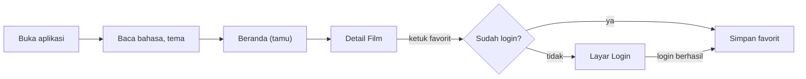
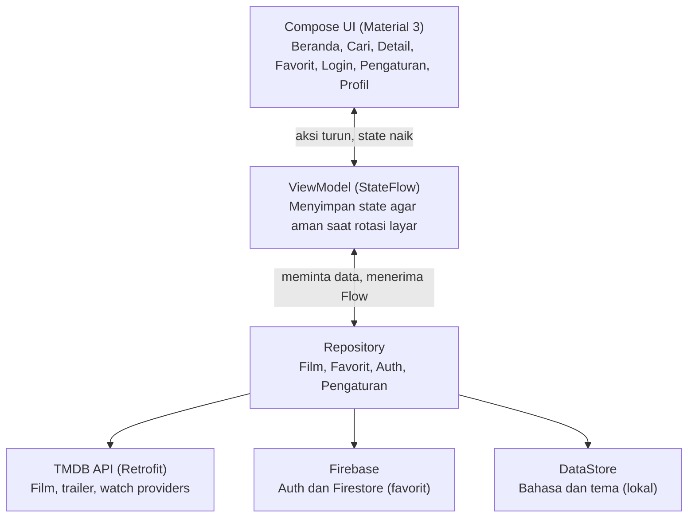

# PRD CiLog (Android, Jetpack Compose)

22 November 2026

## Ringkasan dan Tujuan

CiLog (Cinema Catalog) adalah aplikasi Android berbasis Jetpack Compose untuk menemukan film lewat data TMDB, dengan akun Firebase agar favorit tersinkron antar perangkat. Aplikasi ini bukan pemutar film: ia hanya menampilkan metadata, trailer, dan informasi layanan tempat film bisa ditonton secara resmi.

**Tujuan produk**

- Katalog film yang nyaman dibaca dalam bahasa Inggris dan Indonesia, termasuk judul dan sinopsis dari API.
- Mode terang dan gelap yang bisa mengikuti sistem atau dipilih manual.
- Tampilan yang tetap utuh dan bisa di-scroll saat layar diputar (portrait dan landscape).
- Favorit per akun yang disimpan di Firebase.

**Metrik keberhasilan MVP (usulan, mohon dikonfirmasi)**

| Metrik | Target |
| --- | --- |
| Sesi bebas crash (Crashlytics) | ≥ 99% |
| Waktu hingga poster pertama tampil di Beranda (jaringan normal) | ≤ 2 detik |
| Pergantian bahasa dan tema | Berlaku tanpa memulai ulang aplikasi |
| Rotasi layar pada layar utama | Posisi scroll dan isian pengguna tidak hilang |

## Target Pengguna

Pengguna utama adalah penonton film berbahasa Indonesia atau Inggris yang ingin mencari film dan menyimpan daftar pilihan di lebih dari satu perangkat. Persona di bawah ini adalah asumsi awal dan belum divalidasi dengan pengguna nyata.

| Persona | Kebutuhan utama | Fitur terkait |
| --- | --- | --- |
| Penjelajah film santai | Melihat film populer dan sedang tayang, membaca sinopsis, menonton trailer | Beranda, Detail, Trailer |
| Pengguna dua bahasa | Berpindah antara bahasa Indonesia dan Inggris tanpa kehilangan isi sinopsis | Pengaturan bahasa, fallback sinopsis |
| Pengguna malam hari | Layar nyaman di tempat gelap dan tidak silau | Mode gelap |
| Pengguna multi-perangkat | Daftar favorit tetap ada setelah ganti HP atau pasang ulang | Login, Favorit di Firestore |
| Pengguna tamu | Mencoba katalog tanpa harus mendaftar dulu | Mode tamu |

## Ruang Lingkup

MVP mencakup katalog film, akun Firebase, favorit, serta pengaturan bahasa dan tema. Hal yang menambah kerumitan besar ditunda ke fase 2.

| Cakupan | Isi |
| --- | --- |
| MVP | Beranda (grid poster dengan kategori), Detail Film, Pencarian, Login Google dan email/password, mode tamu, Favorit di Firestore, Trailer, Watch providers (wilayah ID), Pengaturan bahasa dan tema, Profil dan keluar, hapus akun, atribusi TMDB, Crashlytics |
| Fase 2 | Proxy TMDB lewat Cloud Functions (menyembunyikan API key), cache daftar film dengan Room, layout dua panel untuk tablet dan landscape lebar, sinkronisasi preferensi ke Firestore, daftar tonton dan ulasan, App Check penuh |
| Di luar cakupan | Pemutaran atau unduhan film utuh, API streaming tidak resmi, penggunaan komersial, iklan, pembayaran |

## Alur Pengguna

Pengguna langsung masuk sebagai tamu dan hanya diminta login saat menyimpan favorit.



Setelah login berhasil, pengguna kembali ke layar Detail film yang sama dan favorit langsung tersimpan.

**Navigasi:** bottom navigation dengan tiga tab (Beranda, Cari, Favorit). Pengaturan dan Profil dibuka dari bilah atas. Detail Film bisa dibuka dari ketiga tab.

**Peluncuran:** aplikasi membaca bahasa dan tema dari DataStore sebelum menampilkan UI. Pada peluncuran pertama keduanya mengikuti sistem. Sesi login dicek oleh Firebase Auth, dan tanpa sesi pengguna berstatus tamu.

**Perubahan pengaturan:** mengganti bahasa memperbarui teks UI lewat app locales lalu memuat ulang data TMDB dengan parameter bahasa baru. Mengganti tema langsung mengubah seluruh UI.

**Rotasi layar:** state daftar, posisi scroll, dan isian form disimpan di ViewModel dan `rememberSaveable`. Grid melebar otomatis di landscape. Layar Detail, Login, Pengaturan, dan Profil memakai `verticalScroll`.

**Kasus khusus**

| Situasi | Perilaku yang diharapkan |
| --- | --- |
| Tidak ada internet | Favorit tetap terbaca dari cache Firestore. Daftar TMDB menampilkan pesan dan tombol coba lagi. |
| Sinopsis Indonesia kosong | Tampilkan sinopsis Inggris dengan penanda. |
| Trailer tidak tersedia | Tombol trailer disembunyikan. |
| Watch providers kosong untuk ID | Bagian Tersedia di disembunyikan. |
| Login dibatalkan | Kembali ke Detail tanpa menyimpan favorit. |
| Batas permintaan TMDB tercapai | Pesan ramah dan saran mencoba lagi nanti. |

## Kebutuhan Fungsional

Tabel berikut memuat 14 kebutuhan MVP. Prioritas: P0 wajib untuk MVP, P1 sangat diharapkan, P2 boleh bergeser ke fase 2.

| ID | Fitur | Deskripsi | Prioritas |
| --- | --- | --- | --- |
| F-01 | Beranda | Grid poster dengan chip kategori: Populer, Sedang Tayang, Akan Tayang, Rating Tertinggi. Memuat halaman berikutnya saat scroll (Paging 3) dan tarik untuk menyegarkan. | P0 |
| F-02 | Detail Film | Backdrop, poster, judul, rating, durasi, genre, sinopsis, pemeran, dan film rekomendasi. | P0 |
| F-03 | Pencarian | Kata kunci dengan jeda (debounce) sebelum memanggil API, hasil berupa grid, dan pesan saat kosong. | P0 |
| F-04 | Login | Google Sign-In dan email/password, dengan reset password. | P0 |
| F-05 | Mode tamu | Katalog bisa dibuka tanpa login. Login diminta saat pengguna menyimpan favorit. | P0 |
| F-06 | Favorit | Tambah dan hapus film favorit, disimpan di Firestore per pengguna, tetap terbuka offline lewat cache Firestore. | P0 |
| F-07 | Trailer | Tombol Tonton Trailer memutar video YouTube dari key TMDB. Tombol disembunyikan jika tidak ada trailer. | P1 |
| F-08 | Tersedia di | Daftar layanan resmi untuk wilayah ID dari watch providers. Disembunyikan jika kosong. | P1 |
| F-09 | Pengaturan bahasa | Ikuti sistem, English, atau Bahasa Indonesia. Mengubah teks UI dan parameter bahasa API. | P0 |
| F-10 | Pengaturan tema | Ikuti sistem, Terang, atau Gelap. Berlaku langsung tanpa restart. | P0 |
| F-11 | Fallback sinopsis | Jika sinopsis bahasa Indonesia kosong, tampilkan versi Inggris dengan penanda. | P1 |
| F-12 | Profil | Menampilkan nama dan email, tombol keluar, dan hapus akun. | P0 |
| F-13 | Tentang dan atribusi | Versi aplikasi dan pernyataan atribusi TMDB. | P0 |
| F-14 | Status layar | Kondisi memuat, gagal (dengan tombol coba lagi), dan kosong di semua daftar. | P0 |

## Kebutuhan Non-Fungsional

Bagian ini memuat syarat utama proyek: multi-bahasa, tema, dan rotasi layar, ditambah keamanan dan privasi akibat penggunaan Firebase.

| ID | Area | Kebutuhan |
| --- | --- | --- |
| N-01 | Multi-bahasa | Semua teks UI tersedia dalam Inggris (default, `values/strings.xml`) dan Indonesia (`values-in/strings.xml`). Pergantian bahasa di dalam aplikasi memakai app locales (`AppCompatDelegate.setApplicationLocales`) dan `locales_config.xml`. Parameter `language` TMDB mengikuti pilihan (`en-US` atau `id-ID`). |
| N-02 | Multi-bahasa | Pesan error Firebase Auth, teks izin, dan teks layar login juga diterjemahkan ke kedua bahasa. |
| N-03 | Tema | Material 3 dengan `lightColorScheme` dan `darkColorScheme`. Nilai awal mengikuti `isSystemInDarkTheme()`, pilihan pengguna disimpan di DataStore. Tidak ada kedipan tema saat peluncuran. |
| N-04 | Rotasi | State daftar, posisi scroll, kata kunci pencarian, dan isian form login disimpan di ViewModel dan `rememberSaveable`, sehingga tidak hilang saat Activity dibuat ulang. |
| N-05 | Scroll | Daftar memakai `LazyVerticalGrid` dengan `GridCells.Adaptive`. Layar non-lazy (Detail, Login, Pengaturan, Profil) memakai `verticalScroll(rememberScrollState())` agar seluruh isi terjangkau di landscape dan saat keyboard tampil. |
| N-06 | Performa | Gambar dimuat dengan Coil dan di-cache. Daftar dimuat bertahap dengan Paging 3. |
| N-07 | Offline | Favorit tetap terbaca lewat cache Firestore. Daftar film TMDB tanpa cache di MVP menampilkan pesan error dengan tombol coba lagi. |
| N-08 | Keamanan | Security Rules Firestore membatasi akses ke dokumen milik `uid` pengguna sendiri. API key TMDB tidak dikomit ke repositori publik (dibaca dari `local.properties`). |
| N-09 | Privasi | Kebijakan privasi, formulir Data safety Play Store, dan fitur hapus akun tersedia sebelum rilis. |
| N-10 | Aksesibilitas | Kontras warna memenuhi Material 3 di kedua tema, `contentDescription` pada gambar dan ikon, serta target sentuh minimal 48dp. |
| N-11 | Kompatibilitas | Versi Android minimum belum ditetapkan (lihat Asumsi dan Pertanyaan Terbuka). Perangkat tanpa Google Play Services tidak mendukung Google Sign-In, sehingga login email/password menjadi jalur cadangan. |

## Arsitektur dan Stack Teknologi

Aplikasi memakai MVVM tiga lapisan dengan tiga sumber data: TMDB untuk konten film, Firebase untuk akun dan favorit, DataStore untuk preferensi lokal.



Layar tidak mengakses Retrofit, Firestore, atau DataStore secara langsung. Dengan begitu, penambahan Room atau proxy TMDB di fase 2 hanya mengubah lapisan Repository.

| Area | Pilihan |
| --- | --- |
| Bahasa | Kotlin |
| UI | Jetpack Compose dan Material 3 |
| Arsitektur | MVVM dengan StateFlow dan pola Repository |
| Injeksi dependensi | Hilt |
| Jaringan | Retrofit, OkHttp, kotlinx.serialization |
| Gambar | Coil |
| Navigasi | Navigation Compose |
| Daftar tanpa akhir | Paging 3 |
| Preferensi | DataStore |
| Backend | Firebase Authentication, Cloud Firestore, Crashlytics, App Check (sebelum rilis) |
| Trailer | android-youtube-player atau Intent ke aplikasi YouTube |
| Pengujian | JUnit, Compose UI test, Firebase Emulator Suite |

Versi tiap pustaka ditetapkan saat proyek dibuat dan dicek ke dokumentasi resmi masing-masing.

## Model Data dan Firebase

Firestore hanya menyimpan data milik pengguna (favorit). Data film tetap diambil dari TMDB dan tidak disalin ke Firestore, kecuali ringkasan minimal yang dibutuhkan untuk menampilkan daftar favorit.

**Struktur Firestore**

| Path | Isi |
| --- | --- |
| `users/{uid}` | Profil minimal: `createdAt`, `displayName` (opsional) |
| `users/{uid}/favorites/{movieId}` | `movieId`, `title`, `posterPath`, `releaseDate`, `addedAt` |

Judul dan poster di dokumen favorit hanyalah ringkasan agar daftar favorit bisa tampil cepat. Saat Detail dibuka, data lengkap diambil ulang dari TMDB dengan bahasa yang sedang dipilih.

**Security Rules (garis besar)**

```
rules_version = '2';
service cloud.firestore {
  match /databases/{database}/documents {
    match /users/{uid}/{document=**} {
      allow read, write: if request.auth != null && request.auth.uid == uid;
    }
  }
}
```

Rules perlu diuji dengan Firebase Emulator Suite sebelum rilis, termasuk kasus pengguna lain dan pengguna tanpa login.

**Penyimpanan lokal**

| Data | Penyimpanan | Catatan |
| --- | --- | --- |
| Bahasa dan tema | DataStore | Lokal di MVP, sinkronisasi ke Firestore masuk fase 2 |
| Favorit | Firestore (cache offline bawaan) | Sumber kebenaran ada di cloud |
| Sesi login | Firebase Auth | Dikelola SDK |
| Cache daftar film | Tidak ada di MVP | Room masuk fase 2 |

**Penghapusan akun:** menghapus akun Auth juga harus menghapus subkoleksi `users/{uid}`. Di MVP ini dilakukan dari klien sebelum akun dihapus. Ekstensi Firebase atau Cloud Functions bisa menggantikannya di fase 2.

## Kriteria Penerimaan

Sebuah fitur dianggap selesai jika semua kriteria di barisnya terpenuhi pada perangkat nyata atau emulator, di kedua bahasa dan kedua tema.

| Fitur | Kriteria penerimaan |
| --- | --- |
| F-01 Beranda | Grid tampil 2 kolom di portrait dan lebih banyak kolom di landscape. Scroll ke bawah memuat halaman berikutnya. Tarik untuk menyegarkan memuat ulang halaman pertama. Gagal jaringan menampilkan pesan dengan tombol coba lagi. |
| F-02 Detail | Seluruh isi dapat dijangkau dengan scroll di landscape. Rotasi tidak mengembalikan posisi scroll ke atas. Judul dan sinopsis mengikuti bahasa terpilih. |
| F-03 Pencarian | API tidak dipanggil di setiap ketikan. Kata kunci tetap ada setelah rotasi. Hasil kosong menampilkan pesan khusus. |
| F-04 dan F-05 Login dan tamu | Pengguna tamu dapat membuka Beranda, Detail, dan Pencarian. Menekan favorit saat belum login membuka layar login, lalu kembali ke film yang sama setelah berhasil. Pesan error login tampil dalam bahasa terpilih. |
| F-06 Favorit | Film yang difavoritkan muncul di perangkat lain dengan akun yang sama. Favorit tetap terbuka tanpa internet setelah pernah dimuat. Pengguna A tidak dapat membaca favorit pengguna B (diuji di emulator). |
| F-07 Trailer | Trailer terbuka dari tombol. Film tanpa trailer tidak menampilkan tombol. |
| F-08 Tersedia di | Bagian tampil hanya jika ada layanan untuk wilayah ID. |
| F-09 Bahasa | Mengganti bahasa mengubah semua teks UI dan memuat ulang konten film tanpa restart. Pilihan bertahan setelah aplikasi ditutup. |
| F-10 Tema | Mengganti tema berlaku langsung di semua layar tanpa restart dan bertahan setelah aplikasi ditutup. |
| F-11 Fallback | Film tanpa sinopsis Indonesia menampilkan sinopsis Inggris dengan penanda. |
| F-12 Profil | Keluar mengembalikan ke mode tamu. Hapus akun menghapus data Firestore dan akun Auth setelah konfirmasi. |
| F-13 Atribusi | Logo atau pernyataan TMDB terlihat di layar Tentang. |
| F-14 Status layar | Setiap daftar memiliki tampilan memuat, gagal, dan kosong. |

## Risiko dan Batasan

Risiko terbesar bukan teknis, melainkan ketentuan layanan pihak ketiga dan kewajiban privasi. Syarat dan batas TMDB serta Firebase dapat berubah, jadi perlu dicek di halaman resmi sebelum rilis.

| Risiko | Dampak | Penanganan |
| --- | --- | --- |
| Ketentuan penggunaan TMDB (atribusi, non-komersial) | Aplikasi bisa melanggar syarat atau terkena pembatasan | Cantumkan atribusi di layar Tentang. Cek syarat resmi sebelum rilis. Penggunaan komersial membutuhkan izin terpisah. |
| API key TMDB tertanam di aplikasi | Key bisa diekstrak dan disalahgunakan | Diterima untuk MVP. Proxy Cloud Functions di fase 2 (butuh paket Blaze). |
| Biaya Firestore naik karena banyak baca/tulis | Kuota gratis habis | Hindari listener berlebih, batasi pembacaan daftar favorit, pantau kuota. |
| Security Rules salah | Data pengguna terbuka atau terkunci | Uji dengan Emulator Suite, tinjau sebelum rilis. |
| Kewajiban privasi (akun dan data pengguna) | Penolakan di Play Store | Kebijakan privasi, Data safety, dan fitur hapus akun sebelum rilis. |
| Sinopsis bahasa Indonesia kosong | Layar detail tampak kosong | Fallback ke bahasa Inggris dengan penanda (F-11). |
| Watch providers kosong untuk ID | Bagian tampil kosong | Sembunyikan bagian (F-08). |
| Batas permintaan TMDB tercapai | Daftar gagal dimuat | Pesan ramah dan tombol coba lagi. |
| Perangkat tanpa Google Play Services | Google Sign-In tidak jalan | Login email/password sebagai cadangan. |
| Pergantian bahasa tidak memuat ulang data | UI dan konten tidak sinkron | Jadikan bahasa bagian dari kunci kueri sehingga data dimuat ulang otomatis. |

**Batasan hak cipta:** aplikasi hanya menampilkan metadata dan trailer dari sumber resmi. Tidak ada film utuh yang diputar, diunduh, atau disimpan, dan tidak memakai API streaming tidak resmi.

## Milestone dan Rencana Pengerjaan

Pengerjaan dibagi enam milestone berurutan, masing-masing menghasilkan aplikasi yang bisa dijalankan. Belum ada tanggal karena durasi bergantung pada pengalaman dan waktu yang tersedia (lihat Asumsi dan Pertanyaan Terbuka).

1. **Fondasi:** proyek Kotlin, Hilt, tema Material 3 terang/gelap, DataStore, dan proyek Firebase. *Selesai jika* tema berganti dan bertahan setelah aplikasi ditutup.
2. **Lokalisasi:** `strings.xml` EN/ID, app locales, dan layar Pengaturan. *Selesai jika* bahasa UI berganti tanpa restart.
3. **Jaringan dan Beranda:** Retrofit, TMDB, grid poster dengan Paging 3, layout rotasi. *Selesai jika* grid dan scroll benar di portrait dan landscape.
4. **Detail, Pencarian, dan Trailer:** layar Detail, pencarian dengan debounce, trailer, watch providers, fallback sinopsis. *Selesai jika* kriteria F-02, F-03, F-07, F-08, F-11 terpenuhi.
5. **Akun dan Favorit:** Firebase Auth, mode tamu, Firestore, Security Rules, Profil, hapus akun. *Selesai jika* favorit tersinkron antar dua perangkat dan rules lolos uji emulator.
6. **Penyempurnaan dan rilis:** status memuat/gagal/kosong, atribusi TMDB, Crashlytics, App Check, uji manual (rotasi, bahasa, tema, koneksi lambat), kebijakan privasi, Data safety, rilis uji internal.

## Asumsi dan Pertanyaan Terbuka

Asumsi berikut dipakai agar PRD bisa lengkap. Ubah langsung di tabel atau beri komentar jika ada yang tidak sesuai.

| Asumsi | Status |
| --- | --- |
| Nama aplikasi: CiLog (Cinema Catalog) | Diputuskan, ketersediaan nama belum dicek |
| Metode login: Google Sign-In dan email/password | Asumsi |
| Mode tamu aktif, login diminta saat menyimpan favorit | Asumsi |
| Favorit di Firestore, preferensi bahasa dan tema tetap lokal (DataStore) | Asumsi |
| Room tidak dipakai di MVP, masuk fase 2 sebagai cache | Asumsi |
| Proxy TMDB lewat Cloud Functions ditunda ke fase 2 | Asumsi |
| Wilayah watch providers: Indonesia (ID) | Asumsi |
| Navigasi: bottom navigation (Beranda, Cari, Favorit), Pengaturan dan Profil dari bilah atas | Asumsi |
| Layout dua panel untuk tablet ditunda ke fase 2 | Asumsi |

**Pertanyaan terbuka**

- Apa tujuan proyek: belajar, portofolio, atau rilis ke Play Store? Jawabannya menentukan seberapa ketat kewajiban privasi dan penggunaan TMDB.
- Berapa versi Android minimum (`minSdk`) yang ditargetkan?
- Seberapa berpengalaman pengembang dengan Kotlin dan Compose? Ini mempengaruhi durasi tiap milestone.
- Apakah trailer dan watch providers tetap masuk MVP atau cukup fase 2?
- Apakah perlu opsi masuk anonim Firebase untuk tamu, atau tamu cukup tanpa akun sama sekali?
